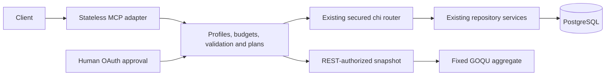

# MCP and AOL architecture

`internal/mcp` is the protocol boundary. `internal/aol` supplies deterministic compositions, strict draft validation, durable plans and conditional compensation. The AAS Environment mounts MCP beside the existing API; individual services are unchanged.

## Security and dispatch

The MCP boundary reuses the REST trustlist and claim normalization, requiring audience validation. Each internal request preserves the original token, cancellation, tracing and server-owned identity context. A fresh chi routing context prevents an outer `/mcp` route from selecting the wrong authorization scope. Dispatch goes through the root router with the configured context path so normal OIDC, ABAC, ReBAC, conditional requests, history and event behavior execute.

Write preflight uses the same ABAC middleware and live policy provider with a non-mutating terminal handler. It only accepts provable full CREATE/READ/DELETE contracts. It grants no additional rights; actual resource requests still traverse the normal router. Mutation decisions, verification and compensation force writer-consistent reads through the existing context facility.

Profiles affect listing and invocation. No tool description is derived from stored product data. Resource IDs are encoded server-side; no caller-supplied HTTP method, backend URL or SQL statement is exposed.

## Read models

The MVP deliberately aggregates a bounded projection returned by the existing authorized `/query/submodels` path. This reuses the complete current QueryFilter and visibility implementation rather than maintaining a parallel authorization-to-SQL compiler. Hidden rows, fragments and predicate fields remain the responsibility of the existing query authorization boundary.

GOQU builds fixed aggregations over a parameterized JSONB projection; aggregation SQL never reads BaSyx base tables. It executes in a read-only transaction with a local statement timeout, using the configured reader pool. Query conditions are ordinary shared AASQL expressions. Scans exceeding row, call or response budgets fail; partial aggregates are prohibited. This favors correctness for the bounded MVP and is not an unbounded warehouse query interface.

## Durable writes

`aol_plan` stores immutable drafts, owner identity, canonical payload hashes, approval hashes and optimistic state versions. Bearer tokens are never stored. `aol_event` records transitions with `agent.session_id`, `aol.plan_id` and `mcp.tool` in the same transaction as the transition. `aol_receipt` records created identifiers and assigned resource revisions.

The existing conditional-write transaction flush has a context-scoped revision observer. AOL uses it to insert the receipt after revision assignment but before the resource transaction commits. If receipt insertion fails, the mutation cannot commit. Unrelated requests have no observer. Existing repository code and its registry/discovery side effects remain authoritative.

Normal states are `planned -> applying -> applied -> rolling_back -> rolled_back`. Creation failures become `compensated` after successful reverse-order deletion, or `recovery_required` when cleanup fails. Rollback conflicts become `conflict`. An expired execution lease makes an interrupted operation eligible for explicit recovery. Single-use approval and state transitions use optimistic compare-and-swap for multi-instance safety.

This is a durable saga, not a cross-resource transaction. It cannot promise immediate all-or-nothing behavior during a database outage or permission revocation. Changed resources are preserved. Multi-step rollback may itself require recovery if a later conditional delete conflicts after an earlier delete succeeded.

## Protocol, documentation and telemetry

The official Go SDK is pinned in `go.mod`. Stateless Streamable HTTP avoids session identity reuse; the hosted OAuth/PKCE approval page supports clients without elicitation. Browser login state is short-lived and held only in memory, so a browser login interrupted by restart must be repeated. Plans and consumed approvals are durable across restart.

Documentation is embedded from the source tree, including OpenAPI. AASQL validation and field-reference generation use the existing grammar/resolver. One `mcp.tool/<name>` span parents nested dispatch spans. Metrics use tool/outcome labels, never resource IDs, plan IDs, user subjects or payloads.

## Verification

Unit tests cover dispatch identity, strict validation, confirmation binding/replay/expiry, audit transition rollback, profile restrictions, protocol errors and execution-free dry runs. Live tests under `internal/mcp/integration_tests` cover OIDC, reads, queries, resources/prompts, restricted aggregates, human approval, creation, compensation and rollback conflicts.

Run the complete repository integration suite with a clean test cache; do not filter it with `-run`. Review the complete PR diff for one new database patch, correct schema registration, license headers, and Changie metadata. Before creating a release fragment, obtain the actual PR number; do not invent a number or commit an invalid placeholder.
